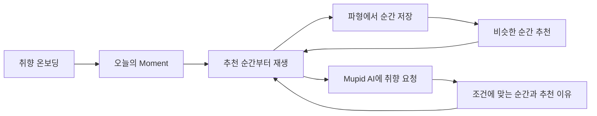
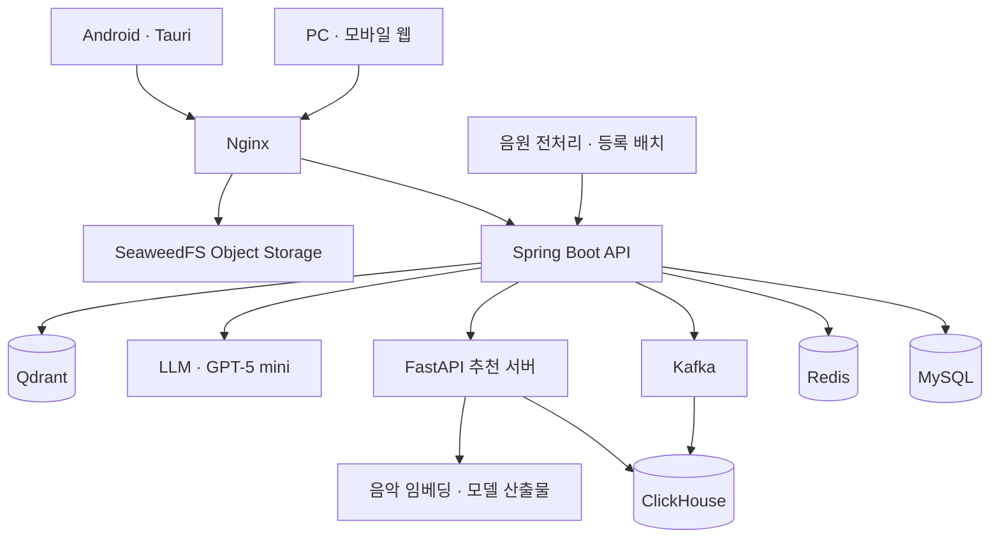

<div align="center">


# MUPID · 뮤피드

**좋아했던 순간이 다음 음악이 되는 곳**

청취 행동과 음악의 구간별 특징을 분석해, 취향에 맞는 **곡과 그 안의 순간**을 추천하는 음악 서비스

SSAFY 15기 특화 프로젝트 · 빅데이터 분산 · **오순도순 A204**

[서비스](https://j15a204.p.ssafy.io) · [GitLab](https://lab.ssafy.com/s15-bigdata-dist-sub1/S15P21A204)

</div>

---

## 목차

- [프로젝트 소개](#프로젝트-소개)
- [주요 기능](#주요-기능)
- [사용자 흐름](#사용자-흐름)
- [시스템 구성](#시스템-구성)
- [핵심 기술](#핵심-기술)
- [기술 스택](#기술-스택)
- [트러블슈팅](#트러블슈팅)
- [디렉터리 구조](#디렉터리-구조)
- [로컬 실행](#로컬-실행)
- [협업 규칙](#협업-규칙)
- [팀 소개](#팀-소개)
- [관련 문서](#관련-문서)

## 프로젝트 소개

### 사람들은 곡을 듣지만, 취향은 순간에서 드러납니다

어떤 곡은 후렴이 좋아서 반복하고, 어떤 곡은 도입부를 건너뛰고 듣습니다. 곡에 대한 좋아요만으로는 **어느 부분을, 어떤 이유로 좋아했는지** 충분히 표현하기 어렵습니다.

뮤피드는 이 차이에 주목합니다. 음악을 Intro, Verse, Chorus 등의 구간으로 나누고, 재생·이동·스킵·순간 저장 같은 행동을 구간 정보와 연결합니다. 이를 바탕으로 사용자가 좋아할 곡뿐 아니라 **바로 들어볼 만한 시작 지점**까지 제안합니다.

발표자료의 사전 설문에서는 ‘취향에 맞는 멜로디와 분위기 추천’, ‘좋아하는 순간을 파악하는 추천’, ‘음악 취향 유형을 보여주는 기능’에 대한 요구를 확인했습니다. 설문은 Google Forms 응답 50명의 편의표본으로, 서비스 기획을 위한 탐색 자료로 활용했습니다.

### 뮤피드가 다루는 취향

| 관점 | 서비스에 반영하는 방식 |
| --- | --- |
| 곡 안의 순간 | 송폼과 구간별 특징을 분석해 추천 구간을 제시합니다. |
| 청취 행동 | 재생 위치, 구간 청취량, 스킵 시점, 저장과 선호 반응을 함께 해석합니다. |
| 개인별 기준 | 온보딩 선호와 누적 행동을 바탕으로 추천 후보의 순위를 조정합니다. |
| 지금의 요청 | 자연어로 표현한 분위기·악기·상황을 추천 조건에 반영합니다. |

청취자는 원하는 음악을 찾는 시간을 줄이고, 아티스트는 곡의 매력적인 구간을 통해 발견될 기회를 얻는 것을 목표로 합니다. 서비스는 이러한 과정에서 쌓인 순간 단위 데이터를 다음 추천에 활용합니다.

## 주요 기능

| 기능 | 설명 |
| --- | --- |
| **취향 온보딩** | 닉네임과 선호 장르·분위기를 선택하고 첫 추천의 기준을 만듭니다. |
| **오늘의 Moment** | 개인화된 순간을 추천받고, 해당 구간부터 음악을 들어봅니다. |
| **음악 플레이어** | 곡 재생, 가사, 파형 탐색, 이전·다음 곡, 반복·셔플, 재생 목록을 제공합니다. |
| **순간 저장** | 파형과 송폼을 참고해 마음에 드는 구간을 선택하고 저장합니다. |
| **비슷한 순간** | 저장하거나 선택한 구간과 닮은 다른 곡의 순간을 추천합니다. |
| **Mupid AI** | “분위기는 유지하고 더 벅차게”처럼 요청하면 조건에 맞는 순간과 추천 이유를 보여줍니다. |
| **음악 탐색** | 검색과 무드·템포·에너지 조건으로 음악을 찾습니다. |
| **플레이리스트** | 원하는 곡을 모으고 재생 목록과 순서를 관리합니다. |
| **취향 리포트** | 청취 기록을 바탕으로 음악 트리맵, 키워드, MuBTI 음악 취향 유형을 확인합니다. |
| **관리자 페이지** | 서비스 데이터와 사용자 행동, 분석 저장소 및 운영 상태를 확인합니다. |

PC·모바일 웹을 지원하며, Android 앱은 같은 프론트엔드 화면을 Tauri 셸로 감싸 사용합니다. 앱에서는 Rust 기반 HTTP 통신, SQLite 저장소, 재생 알림·잠금화면 연동을 제공합니다.

## 사용자 흐름



1. **첫 취향 입력** — 좋아하는 장르와 분위기를 선택합니다.
2. **추천 순간 감상** — 곡의 처음 대신 추천된 구간부터 들어봅니다.
3. **마음에 든 순간 저장** — 파형에서 구간을 선택하고 저장합니다.
4. **새로운 곡 발견** — 저장한 순간과 닮은 다른 곡으로 감상을 이어갑니다.
5. **대화로 추천 조정** — 원하는 분위기나 악기를 말하며 다음 추천을 구체화합니다.

## 시스템 구성



| 구성 | 역할 |
| --- | --- |
| **Frontend / App** | 감상 화면, 구간 선택, 취향 리포트, 청취 이벤트 수집 |
| **Spring Boot API** | 인증, 음악·플레이리스트 관리, 이벤트 검증, AI 대화와 추천 서버 연결 |
| **MySQL / Redis** | 서비스의 관계형 데이터 관리, 캐시와 이벤트 중복 방지 등 |
| **Kafka / ClickHouse** | 청취 이벤트 전달, 분산 저장, 구간별 선호 신호와 분석 데이터 집계 |
| **FastAPI 추천 서버** | 사용자 행동과 음악 특징을 이용한 후보 필터링·점수 계산·순위 결정 |
| **Qdrant** | 음악 순간 벡터의 저장·검색과 벡터 반영 상태 관리 |
| **SeaweedFS / Nginx** | 음원·이미지 저장과 인증된 청크 전송 |

운영 배포는 **Kubernetes(k3s)** 기반이며, GitLab CI/CD와 Ansible로 빌드·배포 및 클러스터 구성을 관리합니다. `infra/`에는 기존 Compose 배포 자료와 공통 CI 설정이, `infra_k8s/`에는 현재 Kubernetes 배포 구성이 있습니다.

## 핵심 기술

### 1. 청취 행동을 순간 단위의 선호 신호로 변환

클라이언트는 행동 종류와 재생 위치, 진입 경로 등을 수집합니다. API는 이벤트를 검증하고 Kafka로 전달하며, ClickHouse에서 곡의 구간 정보와 연결합니다.

| 수집 정보 | 활용 |
| --- | --- |
| 재생과 청취 범위 | 특정 구간을 얼마나 들었는지 계산 |
| 재생 이동 전·후 위치 | 어떤 지점을 건너뛰거나 다시 찾았는지 분석 |
| 순간 저장과 선호 반응 | 관심 있는 구간에 명시적 선호 신호 부여 |
| 스킵 시점과 조작 방식 | 초반 이탈과 충분히 들은 뒤의 이동 구분 |
| 추천·검색·플레이리스트 등 진입 경로 | 같은 행동도 감상 맥락에 맞춰 해석 |
| 검색 키워드 | 사용자가 직접 표현한 탐색 의도 기록 |

순간 저장(`SECTION_MARK`)은 `+1.5`의 신호로 기록됩니다. 스킵은 무조건 부정으로 처리하지 않고 다음처럼 구분합니다.

| 분류 | 조건 | 가중치 |
| --- | --- | ---: |
| `SKIP_AFTER_HOOK` | 해당 순간을 50% 초과 청취한 이력이 있음. 다른 분류보다 우선 적용 | `0.0` |
| `EARLY_SKIP` | 순간 시작 후 5초 또는 길이의 20% 이내 이탈 | 추천 진입 시 다음 버튼 `-1.0`, 그 외 스킵 조작 `-0.4`; 비추천 진입 `0.0` |
| `MID_SKIP` | 초반·후반 조건에 해당하지 않는 중간 이탈 | `0.0` |
| `LATE_SKIP` | 순간 길이의 80% 이후 이탈 | `+0.3` |

분류와 가중치의 구현은 [ClickHouse 스키마](api/clickhouse/init/01-schema.sql)에서 확인할 수 있습니다.

### 2. 사용자 행동은 샤딩, 음악 구간 정보는 복제

같은 두 ClickHouse 노드에 데이터 성격이 다른 두 토폴로지를 구성합니다.

| 데이터 | 구성 | 이유 |
| --- | --- | --- |
| 사용자 행동·구간 신호·청취 범위·추천 노출 | **2 Shards × 1 Replica**, `cityHash64(user_id)` 기준 분산 | 사용자별 이벤트를 나누어 저장하고 집계 |
| 음악 구간 정보 | **1 Shard × 2 Replicas**, 모든 노드에 복제 | 각 노드에서 행동의 재생 위치를 동일한 음악 구간에 연결 |

`RANGE_HASHED Dictionary`로 곡과 재생 위치에 대응하는 순간을 조회합니다. 구간 정보가 모든 노드에 존재하므로 각 샤드에서 선호 신호를 계산할 수 있습니다. 상세 구성은 [ClickHouse 문서](api/clickhouse/README.md)를 참고하세요.

### 3. 송폼 분석과 Dual Encoder 기반 추천

음악을 Intro·Verse·Chorus·Bridge·Solo·Outro 등의 구간으로 분리하고, 구간별 음악 특징과 사용자 행동을 추천 입력으로 사용합니다.

발표자료의 추천 모델은 사용자와 음악을 각각 인코딩하는 **Dual Encoder** 구조입니다. 각 인코더는 `Linear → LayerNorm · GELU → Linear`를 거쳐 같은 임베딩 공간의 벡터를 만들고, 코사인 유사도로 사용자와 음악 순간의 관계를 계산합니다.

서비스의 최종 추천에는 모델 점수 외에도 선호 구간의 특징(DNA), 행동 신호, 요청 조건을 함께 반영합니다. 운영 추론은 NumPy로 실행할 수 있도록 구성해 GPU와 PyTorch 없이 서빙하며, 학습된 가중치와 음악 색인은 별도 산출물로 준비합니다.

발표자료에서는 FMA와 Jamendo 관련 데이터·가중치를 학습 자료로, Flow 생성 음원과 자체 수집 행동 로그를 운영 입력으로 소개합니다. 데이터셋·개별 음원·모델 가중치의 이용 조건은 각각의 원본 라이선스와 약관을 따릅니다.

### 4. 자연어를 추천 조건으로 변환하는 Mupid AI


예를 들어 “창밖을 보면서 잔잔한 피아노 음악을 듣고 싶어”라는 문장에서 분위기·악기·상황을 추출합니다. LLM은 요청을 추천 엔진이 처리할 수 있는 `QueryPlan`으로 바꾸고, 추천 서버는 조건에 맞는 후보를 남긴 뒤 점수를 계산합니다.

대화를 생성하는 LLM 게이트웨이와 음악을 고르는 추천 서버는 별도 서비스입니다. API 설정의 `MUPID_AI_BASE_URL`과 `MUPID_RECOMMENDER_BASE_URL`도 각각 다른 대상을 가리킵니다.

### 5. 청크 스트리밍과 인증·파일 전송 분리

음원 전처리 배치는 오디오를 Opus 기반 청크로 나누고 스트림 메타데이터와 함께 등록합니다. 클라이언트는 필요한 청크를 요청해 재생합니다.

다운로드에서는 Spring Security가 접근 권한을 확인하고, `X-Accel-Redirect`를 통해 Nginx가 오브젝트 스토리지의 파일을 전달합니다. 업로드 역시 Nginx의 `auth_request`로 권한을 확인한 뒤 본문을 스토리지로 전송합니다. 큰 음원 본문이 JVM 힙을 거치지 않도록 구성했습니다.

전처리·등록 절차는 [음원 전처리 문서](music_preprocessing/README.md)에 정리되어 있습니다.

## 기술 스택

| 영역 | 기술 |
| --- | --- |
| Frontend | React 19, TypeScript, vinext, Vite 8, Tailwind CSS 4, shadcn/ui, Recharts |
| Android App | Tauri 2, Rust, SQLite, Android SDK/NDK |
| Backend | Java 21, Spring Boot `4.1.2-SNAPSHOT`, Spring Security, Spring Data JPA, Spring Batch, Gradle |
| 서비스 저장소 | MySQL 8.4, Redis 7.4 |
| 데이터 파이프라인 | Kafka, ClickHouse, ClickHouse Keeper |
| AI / Recommendation | Python 3.12, FastAPI, NumPy, pandas, SciPy, PyArrow, Dual Encoder, Qdrant |
| 자연어 처리 | GPT-5 mini 기반 요청 해석 및 Tool Calling |
| 음원 처리 / Storage | FFmpeg, Opus, SeaweedFS, S3 호환 API |
| Infrastructure | Nginx, Docker, Kubernetes(k3s), Ansible, GitLab CI/CD, Lens |
| Collaboration | GitLab, Jira, Husky, Bruno |

세부 버전은 각 모듈의 `package.json`, `build.gradle`, `requirements.txt`와 배포 설정을 기준으로 합니다.

## 트러블슈팅

### ClickHouse 시스템 로그 적체와 Merge 부하

**문제** — CPU wait가 증가하고 Pod 메모리가 상한에 가까워졌습니다. 조사 과정에서 `trace_log` 약 6.7억 행과 짧은 메트릭 기록 주기, TTL 미설정으로 인한 로그 적체를 확인했습니다.

**원인** — 잦은 메트릭 기록과 시스템 추적 로그가 파트 생성·병합을 늘렸습니다. 이 과정의 메모리 할당이 다시 추적 대상이 되면서 시스템 로그 처리 자체가 리소스 경합을 키웠습니다.

**조치** — 불필요한 추적 로깅을 비활성화하고, 메트릭 수집 간격을 1초에서 10초로, flush 간격을 7.5초에서 60초로 조정했습니다. 로그에는 7일 TTL과 일 단위 파티션을 적용했습니다.

| 지표 | 변경 전 | 변경 후 | 감소율 |
| --- | ---: | ---: | ---: |
| MergeTree Parts | 175개 | 22개 | 약 87.4% |
| 로그 용량 | 22.4 GiB | 5.2 MiB | 약 99.98% |
| CPU Load 평균 | 3.3 | 0.35 | 약 89.4% |

위 수치는 **프로젝트 발표자료에 기록된 개선 전후 관측값**입니다. CPU Load는 CPU 사용률(%)과 다른 지표이며, 같은 조건의 일반적인 성능 보장 수치를 뜻하지 않습니다. 설정은 [시스템 로그 구성](infra_k8s/base/clickhouse/server/03-system-logs.xml)에서 확인할 수 있습니다.

## 디렉터리 구조

```text
S15P21A204/
├── frontend/               # 웹 UI, 플레이어, 청취 이벤트 수집
├── app/                    # Tauri 기반 Android 앱 셸
├── api/                    # Spring Boot API와 관리자 페이지
│   ├── docs/               # Bruno API 컬렉션
│   ├── clickhouse/         # 분석 스키마, 로컬 클러스터, 검증 도구
│   └── knowledge/         # 아키텍처, 설계 결정, 장애 기록
├── ai_server/              # 추천 서버, 모델 서빙, 데이터 배치
├── music_preprocessing/    # 음원 청킹, 카탈로그·가사·스트림 등록
├── flow_music_automation/  # 생성 음원 수집·처리 자동화
├── infra_k8s/              # Kubernetes, Ansible, 운영 배포
├── infra/                  # 공통 CI와 기존 Compose 운영 자료
├── prototype/              # 초기 프론트엔드 프로토타입
├── 진행사항/               # 개인별 진행 기록
├── 회고/                   # 팀 회고
├── .husky/                 # 커밋 메시지 검증
└── .gitlab-ci.yml          # CI/CD 파이프라인
```

## 로컬 실행

### 사전 준비

| 항목 | 필요 조건 |
| --- | --- |
| 저장소 접근 | SSAFY GitLab 저장소를 읽을 수 있는 계정 |
| Frontend | Node.js **22.13.0 이상**, npm |
| Backend | JDK **21**, 저장소의 Gradle Wrapper |
| 공통 인프라 | Docker와 Docker Compose |
| AI 서버 | Python **3.12**, uv, 모델·색인 산출물 |
| 음원 전처리 | Python **3.12 이상**, uv, libopus를 포함한 FFmpeg |
| Android 앱 | Rust, Tauri CLI, Android SDK/NDK, 앱 빌드용 JDK |

**클론만으로 전체 서비스 데이터가 준비되지는 않습니다.** MySQL 스키마, 음악 카탈로그·음원, 추천 모델 산출물과 각 서비스의 환경 설정이 필요합니다. 특히 MySQL 테이블은 애플리케이션이 자동 생성하지 않으므로 팀에서 관리하는 스키마를 먼저 적용해야 합니다. [스키마 관리 결정](api/knowledge/decision/0011-jpa-manages-schema.md)을 참고하세요.

아래 명령은 별도 표시가 없으면 Bash 기준입니다. 각 서버는 별도 터미널에서 실행합니다.

### 1. 저장소와 Git 훅 준비

```bash
git clone https://lab.ssafy.com/s15-bigdata-dist-sub1/S15P21A204.git
cd S15P21A204
npm install
```

루트의 npm 패키지는 Husky 관리용입니다. 프론트엔드 의존성은 `frontend/`에서 별도로 설치합니다.

### 2. 인프라와 Backend

```bash
cd api
cp .env.example .env
# .env의 연결 정보와 인증 값을 로컬 환경에 맞게 설정
docker compose up -d
# MySQL 스키마 준비 및 초기화 컨테이너 완료 확인 후 실행
./gradlew bootRun
```

Windows PowerShell에서는 `Copy-Item .env.example .env`, `./gradlew.bat bootRun`을 사용합니다. 기존 `.env`가 있다면 복사 대신 필요한 설정만 확인합니다.

주요 설정은 다음과 같습니다. 전체 항목은 [API 환경 설정 예시](api/.env.example)를 기준으로 합니다.

| 설정 | 용도 |
| --- | --- |
| `MUPID_MYSQL_*`, `MUPID_REDIS_*` | 서비스 DB와 Redis 연결 |
| `MUPID_JWT_SECRET` | JWT 서명 키 |
| `MUPID_S3_*` | 음원·이미지 스토리지 연결 |
| `MUPID_CLICKHOUSE_*`, `MUPID_KAFKA_*` | 행동 데이터 수집·분석 |
| `MUPID_GMAIL_*` | 이메일 인증·메일 전송 |
| `MUPID_AI_GMS_KEY`, `MUPID_AI_BASE_URL`, `MUPID_AI_MODEL` | LLM 게이트웨이 연결 |
| `MUPID_RECOMMENDER_BASE_URL` | 추천 서버 주소. 로컬 실행 예: `http://127.0.0.1:8100` |
| `MUPID_RECOMMENDER_INTERNAL_TOKEN` | 추천 서버의 내부 호출 토큰과 동일하게 설정 |
| `MUPID_QDRANT_*` | 순간 벡터 저장소 연결 |

로컬 Compose에는 MySQL·Redis·Nginx·스토리지와 Kafka·ClickHouse 분석 스택이 포함됩니다. 초기화 컨테이너는 정상 완료 시 `Exited (0)` 상태가 됩니다.

```bash
curl http://localhost:8080/api/actuator/health  # Nginx 경유
curl http://localhost:8800/api/actuator/health  # API 직접 호출
```

위 포트는 Compose 기본값 기준입니다. `.env`에서 변경했다면 해당 포트로 접속합니다.

### 3. Frontend

저장소 루트의 새 터미널에서 실행합니다.

```bash
cd frontend
npm ci
MUPID_API_ORIGIN=http://localhost:8080 npm run dev
```

PowerShell에서는 다음처럼 설정합니다.

```powershell
cd frontend
npm ci
$env:MUPID_API_ORIGIN = 'http://localhost:8080'
npm run dev
```

터미널에 표시되는 개발 서버 주소로 접속합니다. Vite 프록시 기본 대상은 `localhost:9900`이므로, 로컬 Compose 기본 Nginx 포트인 `8080`을 사용할 때는 위와 같이 `MUPID_API_ORIGIN`을 맞춥니다.

### 4. AI 추천 서버

저장소 루트에서 환경을 준비합니다.

```bash
cd ai_server
uv venv --python 3.12
uv pip install -r requirements.txt
cp .env.example .env
cd ..
```

`ai_server/.env`에 `MUPID_AI_ARTIFACT_DIR`과 ClickHouse 연결 정보를 설정하고, 해당 경로에 모델·색인 산출물을 배치합니다. 내부 호출 토큰을 사용하면 API의 `MUPID_RECOMMENDER_INTERNAL_TOKEN`과 추천 서버의 `MUPID_AI_INTERNAL_TOKEN`을 동일하게 설정합니다.

```bash
# Linux / macOS: 저장소 루트에서 실행
ai_server/.venv/bin/python -m ai_server.tools.serve --check
ai_server/.venv/bin/python -m ai_server.tools.serve
```

```powershell
# Windows: 저장소 루트에서 실행
./ai_server/.venv/Scripts/python.exe -m ai_server.tools.serve --check
./ai_server/.venv/Scripts/python.exe -m ai_server.tools.serve
```

기본 포트는 `8100`입니다. `/health`와 `/internal/ready`에서 상태를 확인합니다. 색인·가중치·개인화 데이터 준비 조건은 [AI 서버 문서](ai_server/README.md)를 따릅니다. 내부 토큰을 설정한 경우 내부 경로 호출에는 인증이 필요합니다.

### 5. 빌드와 검증 명령

| 대상 | 실행 위치 | 명령 |
| --- | --- | --- |
| Frontend 타입 검사 | `frontend/` | `npx tsc --noEmit --incremental false` |
| Frontend 린트 | `frontend/` | `npm run lint` |
| EC2/Nginx용 정적 빌드 | `frontend/` | `npm run build:ec2` |
| 앱용 정적 빌드 | `frontend/` | `npm run build:static` |
| Backend 테스트 | `api/` | `./gradlew test` |
| Backend 빌드 | `api/` | `./gradlew build` |
| Android 개발 실행 | `app/` | `cargo tauri android dev` |
| Android APK 빌드 | `app/` | `cargo tauri android build --apk --target aarch64` |

Backend 명령은 Windows에서 `./gradlew.bat`로 실행합니다. 테스트별 DB·서비스 의존 조건과 앱 개발 환경은 각 모듈 문서를 참고하세요.

## 협업 규칙

### 브랜치와 커밋

브랜치명에는 Jira 티켓 번호 `S15P21A204-<숫자>`를 포함합니다.

```text
back/feat/S15P21A204-44-husky-setting
ai/feat/S15P21A204-220-qwen-query-plan
```

커밋 제목 형식은 `<type>(<scope>): <설명>`이며, `scope`는 선택입니다.

| Type | 용도 |
| --- | --- |
| `feat` | 기능 추가 |
| `fix` | 오류 수정 |
| `docs` | 문서 작성·수정 |
| `chore` | 설정·관리 작업 |
| `refactor` | 기능 변화 없는 구조 개선 |
| `test` | 테스트 추가·수정 |
| `ci` | CI/CD 변경 |

Husky가 브랜치에서 티켓 번호를 추출해 제목 끝에 자동으로 추가합니다.

```text
feat(auth): 로그인 API 구현
→ feat(auth): 로그인 API 구현 (S15P21A204-44)
```

티켓 번호가 없거나 제목 형식이 맞지 않으면 커밋을 거부합니다. 회고 봇과 merge·squash, rebase·cherry-pick·revert 진행 중 커밋에는 예외가 적용됩니다. 제목에 해당 티켓이 이미 있으면 중복 추가하지 않습니다.

새로운 Git worktree에서도 루트에서 `npm install`을 실행해야 합니다. Husky 러너는 각 worktree의 로컬 산출물입니다. 과거 커밋에는 `[S15P21A204-44]` 형식도 있으므로 티켓 검색 시 `S15P21A204-[0-9]+` 패턴을 사용합니다.

구현: [커밋 훅](.husky/commit-msg) · [Git 컨벤션 관련 기록](api/knowledge/failure/git-and-convention.md)

### CI/CD

Merge Request의 `Frontend`·`Backend`·`AI`·`Data`·`Infra` 영역 라벨에 따라 검증 파이프라인을 선택하고, 게이트에서 필요한 검증의 수행 여부를 확인합니다. 운영 패키징과 배포는 Kubernetes 배포 파이프라인으로 연결합니다.

진입점: [GitLab CI 설정](.gitlab-ci.yml) · [Kubernetes 배포 파이프라인](infra_k8s/ci/k8s-release.yml)

## 팀 소개

**오순도순 A204** — 발표자료의 팀 구성 기준입니다.

| 이름 | 담당 |
| --- | --- |
| 이규원 | 팀장 · PM · Frontend |
| 김건우 | Infrastructure |
| 안규리 | Backend · Data Engineering |
| 정예준 | Backend |
| 정준호 | AI |

## 관련 문서

| 문서 | 내용 |
| --- | --- |
| [Frontend](frontend/README.md) | 화면 구성과 프론트엔드 개발 안내 |
| [Android 앱](app/README.md) | Tauri 셸과 네이티브 연동, 앱 빌드 |
| [Backend API](api/README.md) | API 개발 환경과 설정 |
| [API 컬렉션](api/docs/) | Bruno 요청 모음 |
| [아키텍처와 설계 기록](api/knowledge/README.md) | 구조, 설계 결정, 실패·학습 기록 |
| [ClickHouse](api/clickhouse/README.md) | 분석 클러스터와 이벤트 파이프라인 |
| [AI 추천 서버](ai_server/README.md) | 추천 API, 모델 산출물, 배치와 서빙 |
| [음원 전처리](music_preprocessing/README.md) | 음원 청킹과 카탈로그·가사·스트림 등록 |
| [생성 음원 자동화](flow_music_automation/README.md) | 생성 음원 수집·처리 흐름 |
| [Kubernetes 구성](infra_k8s/README.md) | 클러스터와 배포 구성 |
| [Kubernetes 운영](infra_k8s/OPERATIONS-K8S.md) | 배포·검증·롤백 절차 |
| [진행사항](진행사항/README.md) · [회고](회고/README.md) | 프로젝트 진행과 회고 기록 |

---

<div align="center">

**MUPID · 좋아했던 순간이 다음 음악이 되는 곳**

</div>
