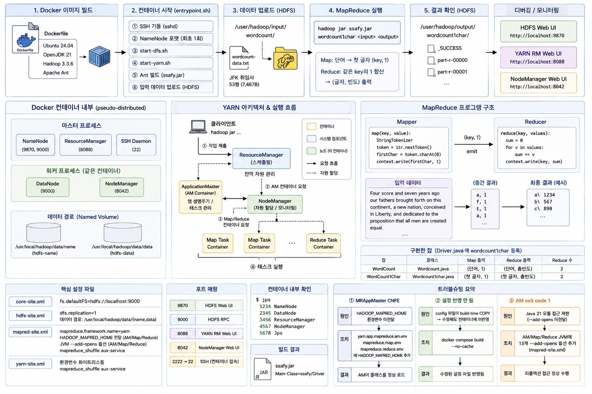

# Hadoop Docker 환경 구축 및 MapReduce 실습



### 목표
Docker 컨테이너에 Hadoop 3.3.6 + Java 21 환경을 구축하고, MapReduce WordCount 실습을 실행한다. 원격 서버가 아닌 단일 컨테이너 pseudo-distributed 모드로 YARN·HDFS를 구성한다.

### 환경 / 설정

| 항목 | 값 |
|---|---|
| 플랫폼 | Docker (Ubuntu 24.04) · 단일 컨테이너 pseudo-distributed |
| Hadoop | 3.3.6 (원본 skeleton은 3.2.2 + Java 8, Dockerfile에서 3.3.6 + Java 21로 업그레이드) |
| Java | OpenJDK 21 (원본 skeleton은 Java 8) |
| 빌드 | Apache Ant (`build.xml`, `javac.version=21`) |
| 포트 | 9870 (HDFS Web UI) · 9000 (HDFS RPC) · 8088 (YARN RM Web UI) · 8042 (NM Web UI) · 2222→22 (SSH) |
| 데이터 | `project/data/wordcount-data.txt` — JFK 취임사 53행 (7,467B) |

| 설정 파일 | 핵심 내용 |
|---|---|
| `core-site.xml` | `fs.defaultFS=hdfs://localhost:9000` |
| `hdfs-site.xml` | `dfs.replication=1`, NameNode/DataNode 데이터 경로 `/usr/local/hadoop/data/{name,data}` |
| `mapred-site.xml` | `mapreduce.framework.name=yarn`, `HADOOP_MAPRED_HOME` 환경변수 전달, `--add-opens` JVM 옵션 (AM/Map/Reduce) |
| `yarn-site.xml` | `mapreduce_shuffle` aux-service, 환경변수 화이트리스트 |

---

## 학습 / 실행 과정

```
Dockerfile 빌드 (Ubuntu 24.04 + Java 21 + Hadoop 3.3.6)
  → entrypoint.sh: SSH 기동 → NameNode 포맷(최초 1회) → start-dfs.sh → start-yarn.sh
  → Ant 빌드 (project/src/*.java → ssafy.jar, Main-Class=ssafy/Driver)
  → HDFS 입력 데이터 업로드 (/user/hadoop/input/wordcount/)
  → hadoop jar ssafy.jar wordcount1char <input> <output>
  → Map: StringTokenizer로 단어 추출 → 첫 글자 (key, 1) emit
  → Reduce: 같은 key의 1을 합산 → (글자, 빈도) 출력
```

### 구현한 MapReduce 잡

| 잡 | 클래스 | Map 출력 | Reduce 출력 | Reduce 수 |
|---|---|---|---|---|
| WordCount | `Wordcount.java` | (단어, 1) | (단어, 총빈도) | 2 |
| WordCount1Char | `Wordcount1char.java` | (단어의 첫 글자, 1) | (첫 글자, 총빈도) | 2 |

- `Driver.java`에서 `wordcount`는 주석 처리, `wordcount1char`만 등록된 상태.
- 두 잡의 구조는 동일 — Mapper의 `word.set()`에서 `itr.nextToken()` vs `String.valueOf(itr.nextToken().charAt(0))`만 다름.
- `IntSumReducer`는 `Iterable<IntWritable>`을 순회하며 합산 → `result.set(sum)` → `context.write(key, result)`.
- `job.setNumReduceTasks(2)` — 2개의 Reducer로 분산 처리.

### 템플릿 과제 (18종, 미구현)

| 분류 | 템플릿 | TODO 수 |
|---|---|---|
| 행렬 연산 | MatrixAdd, MatrixMulti (×4 변형) | 0~5 |
| 조인 | AllPairJoin, AllPairPartition, AllPairPartitionSelf, RPJoin, RPJoinSort, SetSimJoin, CommonItemCount | 1~4 |
| 유사도 검색 | VecSimJoin, VecSimTopKJoin, TopKSearch, KNNJoin | 4~7 |
| 클러스터링 | KMeans | 4 |
| 분류 | LabelRatio | 5 |

*데이터 파일 13종(`data/` 디렉터리)이 각 과제별 입력으로 준비됨.*

---

## 결과

| 지표 | 값 | 비고 |
|---|---|---|
| 컨테이너 구동 | HDFS(NameNode+DataNode) + YARN(RM+NM) 정상 기동 | `jps`로 5개 데몬 확인 |
| Ant 빌드 | `ssafy.jar` 생성 성공 | Main-Class=`ssafy/Driver` |
| WordCount1Char 실행 | YARN에 정상 제출·완료 | `wordcount-data.txt` 입력 |
| HDFS 데이터 업로드 | `/user/hadoop/input/wordcount/` 자동 업로드 | entrypoint.sh에서 수행 |

### 관찰한 것 / 인사이트
- 원본 skeleton(`install-all.sh`)은 Java 8 + Hadoop 3.2.2 기반이지만, Dockerfile에서 Java 21 + Hadoop 3.3.6으로 업그레이드했다. 이 조합은 Hadoop 커뮤니티 공식 지원 범위를 벗어나며, Java 21의 모듈 시스템(JPMS)이 Hadoop의 리플렉션 기반 내부 동작을 차단하는 것이 핵심 장애 요인이었다.
- `entrypoint.sh`가 컨테이너 시작 시 NameNode 포맷(최초 1회) → HDFS/YARN 기동 → Ant 빌드 → 입력 데이터 업로드를 자동화한다. `docker-compose.yml`에서 HDFS 메타데이터를 named volume(`hdfs-name`, `hdfs-data`)으로 영속화하므로 재시작 시 포맷이 생략된다.
- `docker-compose.yml`이 `./project`를 컨테이너에 마운트하지만, 설정 XML 파일은 이미지 빌드 시 `COPY`로 복사된다. 즉 설정 파일 수정 후에는 `docker compose build --no-cache`로 재빌드해야 반영된다 — 이게 두 번째 트러블슈팅의 원인이었다.

> **배운 것** — Docker에서 Hadoop 설정 파일을 다루려면 "이미지 빌드 시 복사(copy)"와 "볼륨 마운트(mount)"의 차이를 명확히 구분해야 한다. 마운트된 파일은 호스트 수정 즉시 반영되지만, 빌드 시 복사된 파일은 재빌드해야 갱신된다.

---

## 트러블슈팅

### ① MRAppMaster ClassNotFoundException

| | 내용 |
|---|---|
| **증상** | MapReduce 잡 제출 시 AM(ApplicationMaster)이 `ClassNotFoundException`로 실패. |
| **원인** | `mapred-site.xml`에 `HADOOP_MAPRED_HOME` 환경변수를 YARN 컨테이너에 전달하는 설정(`yarn.app.mapreduce.am.env`, `mapreduce.map.env`, `mapreduce.reduce.env`)이 없어, YARN이 MapReduce JAR를 찾지 못함. |
| **조치** | 세 설정에 `HADOOP_MAPRED_HOME=/usr/local/hadoop` 추가. |
| **결과** | AM이 정상적으로 MapReduce 클래스패스를 찾아 기동. |

> **배운 것** — YARN 컨테이너는 독립된 JVM으로 실행되므로, 호스트의 환경변수가 자동으로 전달되지 않는다. `mapred-site.xml`의 `*.env` 설정은 "YARN이 띄운 컨테이너에 환경변수를 주입하는" 유일한 공식 경로다.

### ② 설정 반영 안 됨 (같은 에러 반복)

| | 내용 |
|---|---|
| **증상** | `mapred-site.xml`을 수정했는데도 같은 에러가 반복됨. |
| **원인** | `docker-compose.yml`에 `mapred-site.xml` volume 마운트가 없어, 호스트에서 수정해도 컨테이너(이미지 빌드 시 복사된 파일)에는 반영되지 않음. |
| **조치** | `docker compose build --no-cache`로 이미지 재빌드. |
| **결과** | 수정된 설정 파일이 컨테이너에 반영됨. |

> **배운 것** — Docker에서 "파일을 수정했다"와 "컨테이너에 반영됐다"는 다르다. 파일이 volume mount인지 build-time copy인지 확인하는 것이 먼저다. `--no-cache`는 마지막 수단이지만, `COPY` 계층은 캐시되므로 설정 변경 시 필요하다.

### ③ AM exit code 1 (Java 21 모듈 접근 제한)

| | 내용 |
|---|---|
| **증상** | AM 컨테이너가 exit code 1로 즉시 실패. 로그에 Java 모듈 접근 제한(InaccessibleObjectException) 경고. |
| **원인** | Hadoop 3.3.6 + Java 21 환경에서 YARN 컨테이너 JVM(AM/Map/Reduce)에 `--add-opens` 플래그가 전달되지 않아, Java 21의 강화된 모듈 캡슐화가 Hadoop의 리플렉션 기반 동작을 차단. |
| **조치** | `mapred-site.xml`에 `yarn.app.mapreduce.am.command-opts`, `mapreduce.map.java.opts`, `mapreduce.reduce.java.opts`로 `--add-opens java.base/java.lang=ALL-UNNAMED` 등 13개 모듈 개방 플러그 추가. |
| **결과** | YARN 컨테이너 JVM이 Hadoop 내부 리플렉션을 정상 수행. |

```
--add-opens java.base/java.lang=ALL-UNNAMED
--add-opens java.base/java.lang.invoke=ALL-UNNAMED
--add-opens java.base/java.lang.reflect=ALL-UNNAMED
--add-opens java.base/java.io=ALL-UNNAMED
--add-opens java.base/java.net=ALL-UNNAMED
--add-opens java.base/java.nio=ALL-UNNAMED
--add-opens java.base/java.util=ALL-UNNAMED
--add-opens java.base/java.util.concurrent=ALL-UNNAMED
--add-opens java.base/java.util.concurrent.atomic=ALL-UNNAMED
--add-opens java.base/sun.nio.ch=ALL-UNNAMED
--add-opens java.base/sun.nio.cs=ALL-UNNAMED
--add-opens java.base/sun.security.action=ALL-UNNAMED
--add-opens java.base/sun.util.calendar=ALL-UNNAMED
--add-opens java.security.jgss/sun.security.krb5=ALL-UNNAMED
```

> **배운 것** — Java 9+ 모듈 시스템(JPMS)은 `--add-opens`로 개방하지 않으면 `sun.*` 및 `java.base` 내부 패키지에 대한 리플렉션을 차단한다. Hadoop은 내부적으로 리플렉션을 광범위하게 사용하므로, Java 17+에서는 데몬 JVM(`HADOOP_OPTS`)뿐 아니라 YARN이 띄우는 AM·Map·Reduce 컨테이너 JVM에도 각각 `--add-opens`를 전달해야 한다. `HADOOP_OPTS`는 데몬에만 적용되고 YARN 컨테이너에는 전달되지 않는다는 점이 함정이다.

---

## YARN 아키텍처 정리

> **YARN(Yet Another Resource Negotiator)** — Hadoop 2.0에서 도입된 클러스터 리소스 관리/작업 스케줄링 프레임워크.

**핵심 구성 요소**
- **ResourceManager** (전역 1개): 클러스터 전체의 CPU/메모리 자원을 관리하고, 애플리케이션 스케줄링.
- **NodeManager** (각 노드 1개): 컨테이너 단위로 자원을 할당하고 모니터링.
- **ApplicationMaster** (앱마다 1개): 애플리케이션(MapReduce, Spark 등)의 생명주기/태스크 관리.

**핵심 개념**
- **컨테이너**: CPU·메모리가 할당된 격리된 실행 단위. MapReduce의 AM·Map·Reduce 태스크가 각각 컨테이너에서 실행됨.
- **역사적 의미**: Hadoop 1.x에서는 JobTracker가 자원 관리와 작업 실행을 동시에 담당(확장성 병목). YARN은 자원 관리와 작업 실행을 분리하여, MapReduce뿐 아니라 Spark, Flink, Tez 등 다양한 처리 엔진이 같은 클러스터 자원을 공유할 수 있게 함.

**실행 흐름 (트러블슈팅과 연결)**
1. 클라이언트가 `hadoop jar ...`로 작업 제출 → RM이 AM용 컨테이너 1개 할당.
2. AM이 NM들에 Map/Reduce 태스크 컨테이너 실행 요청.
3. 각 컨테이너는 자체 JVM으로 실행 — 이때 클래스패스(`HADOOP_MAPRED_HOME`)와 JVM 옵션(`--add-opens`)이 컨테이너에 제대로 전달되지 않으면 위에서 겪은 에러가 발생.

즉, YARN은 "클러스터의 자원을 컨테이너로 쪼개어 여러 앱이 공유"하게 해주는 계층이며, `mapred-site.xml`의 설정은 YARN이 띄운 컨테이너 환경을 제대로 구성하기 위한 것이었다.
