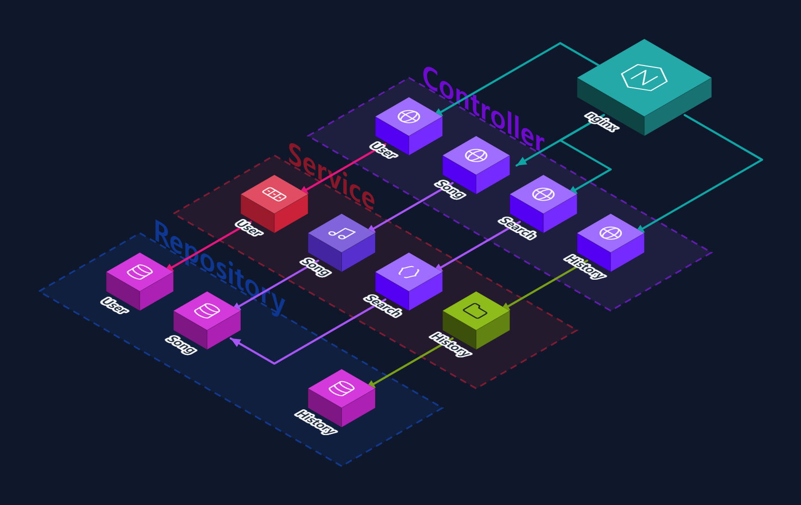

# SpringSecurity · JPA · Flyway (MetaMusic)




### 목표
Spring Boot 4 기반으로 JWT 인증을 적용한 REST API 스켈레톤(MetaMusic)을 구축한다. 세션 없이(STATELESS) 토큰만으로 인증이 성립하는 구조를 만들고, 도메인 단위 패키지 구성·Flyway 마이그레이션·컨테이너 배포까지 이어질 기반을 잡는다.

### 환경 / 설정

| 항목 | 값 |
|---|---|
| 플랫폼 | 로컬 (Java 21, Gradle) |
| Spring Boot | 4.1.1 (Spring Framework 7.0.9) |
| Spring Security | 7.1.1 |
| ORM / 마이그레이션 | Hibernate 7.4.5.Final · Flyway 12.4.0 (+ flyway-mysql) |
| DB | H2 2.4.240 (인메모리, 현재) / MySQL 9.7.0 커넥터 (주석 처리) |
| WAS | Tomcat 11.0.24 embedded, 포트 8080 |
| JWT | JJWT 0.12.5 (api / impl / jackson) |
| 기타 | Lombok, Actuator, DevTools, Bean Validation |

Spring Boot 4에서 스타터가 세분화되어, 3.x의 `spring-boot-starter-web` 대신 **`spring-boot-starter-webmvc`**를 쓰고 Flyway·RestClient·H2 콘솔도 각각 별도 스타터(`spring-boot-starter-flyway`, `spring-boot-starter-restclient`, `spring-boot-h2console`)로 분리되어 있다. 테스트 의존성도 스타터별 `-test` 형태로 나뉜다.

---

## 학습 / 실행 과정

```
패키지 구조 (도메인 기반)
  dev.yejun614.MetaMusic
   ├─ auth
   │   ├─ controller/AuthController        POST /api/auth/login
   │   ├─ request/AuthLoginRequest         record + Bean Validation
   │   └─ service/AuthService(+Impl)       (비어 있음)
   ├─ user
   │   ├─ entity/User, UserRole
   │   └─ repository/UserRepository
   └─ common
       ├─ auth/JwtProvider, AuthFilter
       └─ config/SecurityConfig
```

```
요청 흐름
  요청 → AuthFilter (Authorization: Bearer <token> 파싱)
        → JwtProvider.validateToken       서명·만료 검증
        → JwtProvider.getAuthentication   subject(userId)로 DB 조회 → Authentication 생성
        → SecurityContextHolder에 저장
        → filterChain.doFilter            다음 필터로
        → 인가 판정 (authorizeHttpRequests 규칙 평가)
        → Controller
```

### JWT 설계

| 항목 | Access Token | Refresh Token |
|---|---|---|
| `subject` | userId | userId |
| 클레임 | `role`, `token_type: ACCESS` | `token_type: REFRESH` |
| 유효기간 | 1시간 | 7일 |
| 서명 | HMAC-SHA (`jwt.secret` BASE64 디코딩 → `Keys.hmacShaKeyFor`) | 동일 키 |

- subject를 처음에는 email로 두었다가 **userId로 변경**했다. email은 변경 가능한 값이라, 토큰 발급 이후 이메일을 바꾸면 기존 토큰이 조회에 실패하거나 엉뚱한 사용자를 가리킬 수 있다.
- `token_type` 클레임으로 access/refresh를 구분한다. 이 구분이 없으면 refresh 토큰을 그대로 Authorization 헤더에 넣어 7일짜리 access 토큰처럼 쓸 수 있다.
- refresh 토큰에는 `role`을 넣지 않았다. 재발급 전용이므로 권한 정보를 실을 이유가 없고, 실으면 권한을 변경해도 낡은 권한이 7일간 살아남는다.
- 시크릿은 `${MMUSIC_JWT_SECRET:...}` 형태로 환경변수 주입으로 바꿨다 (`openssl rand -base64 32`).

### SecurityFilterChain

```java
httpSecurity
    .csrf(disable).httpBasic(disable).formLogin(disable)
    .sessionManagement(SessionCreationPolicy.STATELESS)
    .authorizeHttpRequests(it -> it
        .requestMatchers("/api/auth/**").permitAll()      // 로그인, 회원가입
        .requestMatchers("/api/actuator/**").permitAll()  // k8s probe
        .anyRequest().authenticated())
    .addFilterBefore(new AuthFilter(jwtProvider), UsernamePasswordAuthenticationFilter.class)
    .build();
```

- **STATELESS**이므로 서버가 인증 상태를 보관하지 않는다. 매 요청마다 `AuthFilter`가 토큰을 다시 해석해 `SecurityContext`를 채워야 하며, 이 필터가 인증의 유일한 경로다.
- csrf 비활성화가 정당한 이유도 여기서 나온다. CSRF 공격은 브라우저가 쿠키를 자동으로 실어 보내는 것을 전제하는데, 인증 정보가 Authorization 헤더로만 전달되면 그 자동 전송이 일어나지 않는다.
- `addFilterBefore(..., UsernamePasswordAuthenticationFilter.class)` — 폼 로그인 필터 자리 **앞**에 끼워, 인가 판정보다 먼저 컨텍스트가 채워지도록 한다.
- `/api/actuator/**`를 permitAll로 연 것은 쿠버네티스 probe 때문이다. probe 요청에는 토큰이 없으므로 인증을 걸면 401이 되어 파드가 Ready에 도달하지 못한다.

---

## 결과

| 항목 | 값 | 비고 |
|---|---|---|
| `./gradlew test` | **통과** (tests=1, failures=0) | `contextLoads` — 스프링 컨텍스트 기동 확인 |
| `./gradlew bootJar` | 성공 | `MetaMusic-0.0.1-SNAPSHOT.jar` ≈ 66.7MB |
| 컨테이너 이미지 | 성공 | `yejun614/meta-music:0.0.1` ≈ 728MB |
| Flyway 마이그레이션 | **0건 적용** | 로그: `Successfully validated 0 migrations` / `No migrations found` |
| DB 스키마 | **생성되지 않음** | Flyway도 Hibernate DDL도 동작하지 않음 (트러블슈팅 ③) |
| 로그인 API | 미구현 | 더미 User로 토큰만 발급하는 TODO 상태 |

### 관찰한 것 / 인사이트

- **인증 실패를 예외로 던지지 않는 것이 오히려 맞다.** `AuthFilter`는 토큰이 없거나 잘못돼도 `SecurityContext`를 비워둔 채 다음 필터로 넘긴다. 처음엔 여기서 401을 반환해야 할 것 같았지만, 이 필터는 `permitAll` 경로(로그인 요청 포함)도 전부 통과하므로 여기서 던지면 로그인 자체가 불가능해진다. **인증(누구인지 확인)과 인가(접근 허용 여부)는 다른 단계**이고, 401/403 판정은 뒤쪽 인가 단계의 책임이다.
- **`getAuthentication`이 매 요청 DB를 조회한다.** 토큰 클레임만으로 principal을 구성하면 DB 조회 없이 처리할 수 있지만, 그러면 탈퇴·권한변경이 토큰 만료까지 반영되지 않는다. 반대로 매번 조회하면 JWT의 무상태 이점이 줄어든다. 지금은 정확성을 택한 상태이고, 부하가 문제되면 캐시가 다음 선택지다.
- **Spring Security 7에서는 `HttpSecurity.build()`가 checked exception을 던지지 않는다.** 3.x 예제에서 흔히 보이는 `filterChain(HttpSecurity http) throws Exception` 관례가 더 이상 필요하지 않다 (`AbstractSecurityBuilder` → `public final O build();`).
- **Flyway가 클래스패스에 있으면 Hibernate의 자동 DDL이 꺼진다.** Spring Boot는 마이그레이션 도구가 감지되면 `ddl-auto`를 `none`으로 두므로, "Flyway가 마이그레이션을 못 찾는" 상황은 곧 "테이블이 하나도 없는" 상황이 된다. 둘 중 하나라도 알아서 만들어 주리라 기대할 수 없다.
- **`@Builder`가 JPA 기본 생성자를 없앤다.** Lombok `@Builder`는 전체 필드 생성자를 만들고, 명시적 생성자가 생기면 컴파일러의 암묵적 기본 생성자가 사라진다. 이 상태에서도 컨텍스트 기동은 성공하고 Hibernate는 경고만 남기므로, 실제로 엔티티를 조회하는 순간까지 문제가 드러나지 않는다.

> **배운 것** — 스켈레톤이 "빌드되고 기동된다"는 것은 동작을 거의 보장하지 않는다. 이번 경우 테스트도 통과하고 JAR도 이미지도 만들어졌지만 실제로는 **테이블이 없고 엔티티를 인스턴스화할 수도 없는 상태**였다. 기동 로그의 WARN 한 줄과 Flyway의 "0 migrations"가 그 사실을 알려주는 유일한 신호였다. 성공/실패 여부가 아니라 로그를 읽어야 상태를 알 수 있다.

---

## 트러블슈팅

### ① AuthFilter를 통과한 요청이 응답 없이 종료

| | 내용 |
|---|---|
| **증상** | 요청이 컨트롤러에 도달하지 못하고 빈 응답으로 끝남. |
| **원인** | `OncePerRequestFilter.doFilterInternal`에서 인증 주입만 하고 `filterChain.doFilter(request, response)`를 호출하지 않아 필터 체인이 그 지점에서 끊김. |
| **조치** | 인증 주입 이후 `filterChain.doFilter(request, response)` 추가. |
| **결과** | 체인이 정상 연결되어 뒤쪽 필터·컨트롤러까지 도달. |

> **배운 것** — 서블릿 필터의 계약은 요청을 가로채는 것이 아니라 **처리한 뒤 다음으로 넘기는 것**이다. `doFilter`를 부르지 않는 것은 "여기서 응답을 완성했다"는 선언이므로, 인증 필터처럼 통과시켜야 하는 필터에서는 모든 분기에서 `doFilter`가 호출되는지 확인해야 한다.

### ② issueRefreshToken() 컴파일 실패

| | 내용 |
|---|---|
| **증상** | `public String issueRefreshToken() {}` — 반환 타입이 있는데 본문이 비어 컴파일 불가. |
| **원인** | 메서드 시그니처만 먼저 작성하고 구현을 미뤘음. |
| **조치** | `User`를 받아 subject=userId, `token_type: REFRESH`, 만료 7일로 발급하도록 구현. |
| **결과** | `bootJar` 성공. |

### ③ 테이블이 하나도 생성되지 않음

| | 내용 |
|---|---|
| **증상** | 컨텍스트는 정상 기동하지만 스키마가 없음. 로그에 `Successfully validated 0 migrations`, `No migrations found. Are your locations set up correctly?`가 출력되고 `create table` 문은 전혀 없음. |
| **원인** | 마이그레이션 파일명이 `V260827_1330_init.sql`인데, Flyway 명명 규칙은 `V<버전>__<설명>.sql`로 **버전과 설명 사이에 밑줄 두 개**를 요구한다. 단일 밑줄이라 마이그레이션으로 인식되지 않아 무시됨(파일 내용도 비어 있음). 동시에 Flyway가 클래스패스에 있어 Hibernate `ddl-auto`가 `none`이 되므로 자동 DDL도 없음. |
| **조치** | 미조치 — `V260827_1330__init.sql`로 개명하고 `users` 테이블 DDL 작성 필요. |
| **결과** | 현재는 조회 시 "테이블 없음" 오류가 날 상태. |

> **배운 것** — Flyway는 명명 규칙에 맞지 않는 파일을 **에러 없이 그냥 무시**한다. "마이그레이션이 실패했다"가 아니라 "마이그레이션이 0건"이라고만 나오므로, 파일을 만들어 두고 적용됐다고 착각하기 쉽다. 기동 로그에서 적용된 마이그레이션 개수를 반드시 확인해야 한다.

### ④ Hibernate 엔티티 기본 생성자 부재 *(미해결)*

| | 내용 |
|---|---|
| **증상** | 기동 시 WARN — `HHH000182: No default (no-argument) constructor for class [dev.yejun614.MetaMusic.user.entity.User]`. 기동 자체는 성공. |
| **원인** | `User`에 Lombok `@Builder`만 선언되어 전체 필드 생성자가 생기고 암묵적 기본 생성자가 사라짐. Hibernate는 엔티티를 리플렉션으로 인스턴스화하기 위해 인자 없는 생성자를 요구한다. |
| **조치** | 미조치 — `@NoArgsConstructor(access = AccessLevel.PROTECTED)` 추가 필요. |
| **결과** | 기동은 되지만 실제 조회 시 인스턴스화 실패 예상. |

> **배운 것** — Hibernate는 이 문제를 기동 실패가 아니라 **WARN으로 처리**한다. 즉 컨텍스트 로딩만 검증하는 테스트는 통과한다. 엔티티 관련 계약은 리포지토리를 실제로 호출하는 테스트가 있어야 검증된다.

---

## 남은 결함 / 다음 단계

| 항목 | 내용 |
|---|---|
| `UserRepository.findById(int)` | PK가 `Long`인데 `int` 파생 쿼리를 추가하고 `Integer.parseInt(subject)`로 파싱 중 — `Long.parseLong` + `JpaRepository.findById(Long)`로 통일 필요 |
| `User.password` 길이 | `length = 30` — BCrypt 해시(60자) 저장 불가 |
| 감사 필드 | `createdAt`/`updatedAt`이 `nullable = false`인데 자동 설정 장치 없음 (`@CreationTimestamp` 또는 JPA Auditing 필요) |
| 로그인 로직 | `AuthController.login`이 더미 User 토큰 발급 TODO, `AuthService`/`AuthServiceImpl` 비어 있음 |
| Refresh 재발급 | 발급만 구현 — `token_type`을 검증해 access를 재발급하는 엔드포인트 없음 |
| 예외 처리 | `@RestControllerAdvice` 기반 전역 예외 처리 및 Validation 오류 응답 포맷 미작성 |
| DB | H2 인메모리 임시 사용 중 — MySQL 복귀 및 접속 정보 외부화 필요 |
| 도메인 확장 | 아키텍처 설계상 Song·Search 도메인 예정 (`MetaMusic.arch.json`) |

배포 측면의 남은 과제는 [쿠버네티스 활용 분산 서버 배포 및 관리](쿠버네티스_분산_배포.md)의 "매니페스트 검토에서 발견한 문제" ③④ 항목과 이어진다 — replicas 3 + H2 인메모리 조합, JWT 시크릿 기본값의 이미지 포함.

---

## 참고 — 확인된 의존성 버전 *(옵션)*

```
spring-boot             4.1.1        spring-core         7.0.9
spring-security-core    7.1.1        hibernate-core      7.4.5.Final
flyway-core             12.4.0       flyway-mysql        12.4.0
h2                      2.4.240      mysql-connector-j   9.7.0
tomcat-embed-core       11.0.24      jjwt                0.12.5
jakarta.persistence-api 3.2.0
```

*Flyway 12.4.0은 H2 2.3.232까지 검증되어 있어, H2 2.4.240 사용 시 미검증 버전 경고가 출력된다.*
