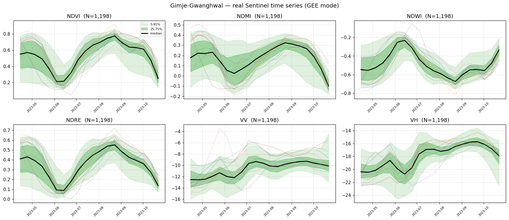
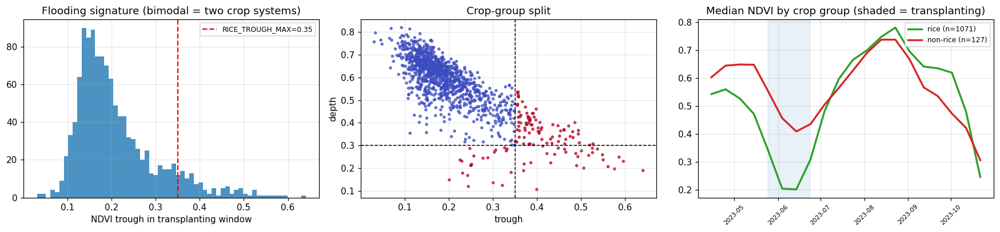
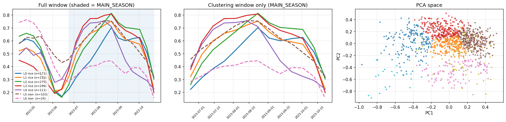
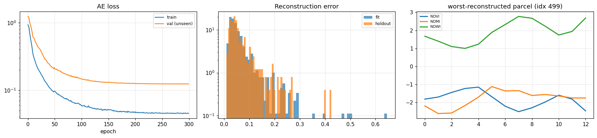
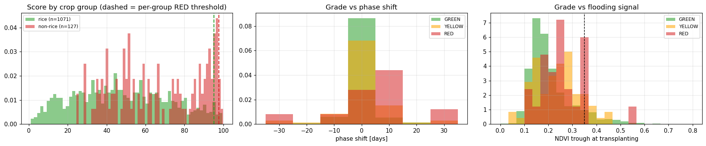
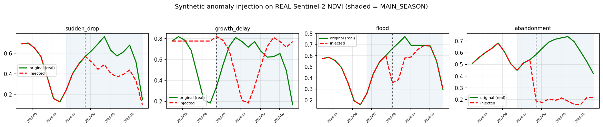
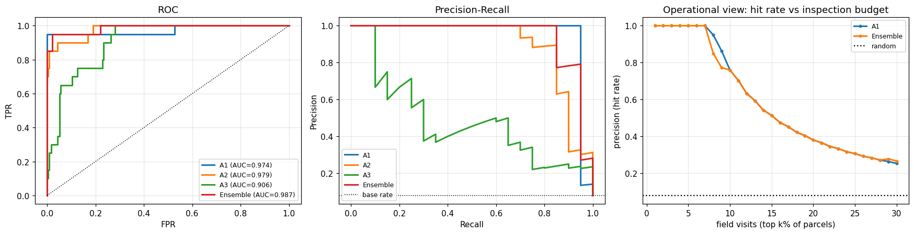
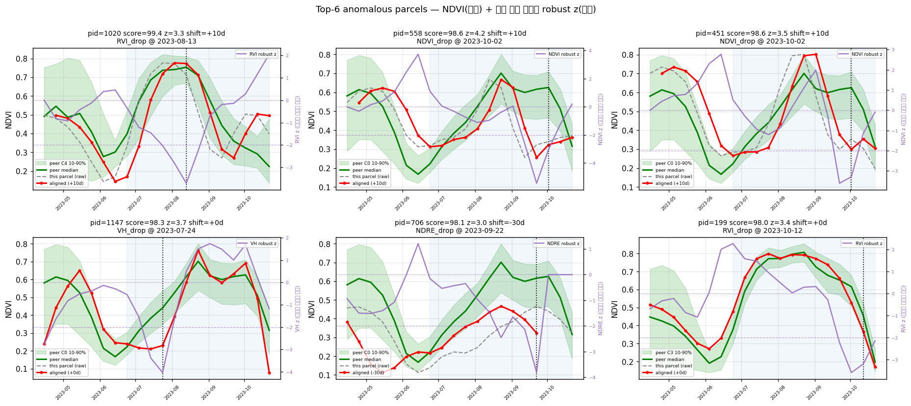
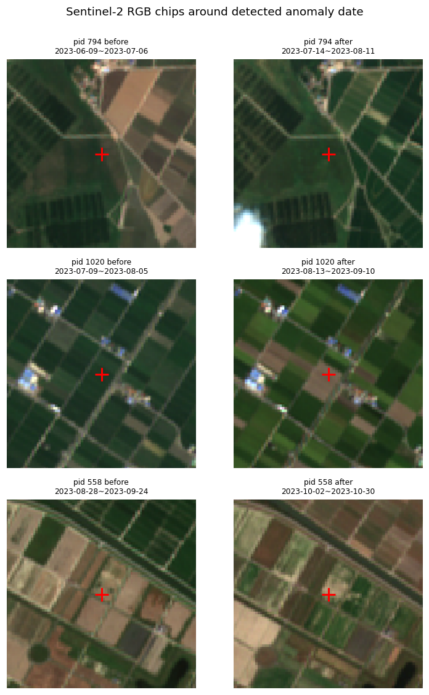
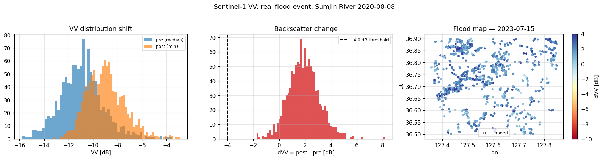

# 위성 기반 전국 농지 이상탐지 모델

### 목표
전국 농지를 위성으로 훡아, 주변 필지와 다르게 자라는 필지를 자동으로 찾아낸다.

### 환경 / 설정

| 항목 | 값 |
|---|---|
| 플랫폼 | 로컬 (Python) |
| 핵심 라이브러리 | xarray, rasterio, scikit-learn, PyTorch |
| 데이터 | Sentinel-2 L2A (STAC) · Sentinel-1 GRD (GEE) · ESA WorldCover v200 · Copernicus DEM GLO-30 |

| 데이터 | 출처 | 인증 | 해상도 |
|---|---|---|---|
| Sentinel-2 L2A | AWS Earth Search STAC | **불필요** | 10~20 m |
| Sentinel-1 GRD | Google Earth Engine | 필요 (무료) | 10 m |
| ESA WorldCover v200 | AWS 공개 COG | **불필요** | 10 m |
| Copernicus DEM GLO-30 | AWS 공개 COG / GEE | 불필요 / 필요 | 30 m |

*GEE(Google Earth Engine)를 사용하기 위해 Google Cloud에서 프로젝트를 등록하는 과정이 필요했다.*

---

## 학습 / 실행 과정

```
AOI (6×6 km)
  → STAC 검색 (구름 70% 이하 장면)
  → 20 m 격자로 로드, SCL로 구름 마스킹
  → 10일 중앙값 합성 (시점 20개)
  → 100 m 격자로 coarsen = "가상 필지" 1 ha
  → WorldCover 농지비율 ≥ 60% 필터
  → 관측 유효율 ≥ 55% 필터
  → 지수 계산 (NDVI, NDMI, NDWI, NDRE) + SAR (VV, VH, RVI)
  → 작물군 분리 → peer group → 이상 점수 → 등급
```

### 모델 앙상블

| 이름 | 방법 | 목적 |
|---|---|---|
| **A1** | 위상정렬 robust z-score (median/MAD) | 주변 대비 편차 |
| **A2** | Conv1D AutoEncoder 재구성 오차 | 학습한 정상 패턴에서 벗어난 형태 |
| **A3** | Isolation Forest (생육 특징 공간) | 특징 공간의 고립점 |

### 데이터 검증 — 이게 정말 벼 생육곡선인가?

전처리 후 **데이터가 물리적으로 맞는지 눈으로 확인**했다. 논이라면 5월 하순 이앙·담수기에 NDVI가 낮고(0.2~0.3) NDWI가 상승하며 VV가 급락(경면반사)해야 한다.



| 검증 항목 | 실측값 | 정상 기준 | 판정 |
|---|---|---|---|
| 중위 NDVI 최대 시점 | 2023-08-23 | 벼면 8월 전후 | ✅ |
| 중위 NDVI 최대값 | 0.775 | 벼 논은 0.80 이상 | 🔶 약간 낮음 |
| 중위 NDVI 진폭 | 0.563 | 0.5 이상이면 단일 작물 | ✅ |
| VV 최저 시점 | 2023-04-25 | 이앙 담수기와 일치 | ✅ |
| NDWI 최대 시점 | 2023-06-14 (값 −0.232) | 이앙 담수기와 일치 | ✅ |
| 이모작 판정 | 골짜기 2023-06-04 (겨울작물 수확 + 이앙) | — | ✅ MAIN_SEASON 6/15 시작 적절 |

### 논/비-논 분리 — 담수 신호 기반 하드 분리

위상 정렬 후 최상위 이상 필지가 **이앙 담수 흔적이 없는 필지**로 바뀌었다. NDVI 형상만으로 군집화하면 논과 밭이 섞이므로, 이앙기 NDVI 최저값(담수 신호)으로 작물군을 물리적으로 분리했다.



| 항목 | 값 |
|---|---|
| 이앙 논 | 1,071필지 (89.4%) |
| 비-논 | 127필지 (10.6%) |
| 2성분 혼합모형 추정 임계 | 0.261 (설정값 0.35, 차이 0.089) |
| 분리 타당성 | ✅ 이봉 분포 확인, 비-논 곡선에 6월 초 골짜기 없음 |

### 군집화 — 작물/생육 유형 대리 분류

작물군 안에서 곡선 형태(PCA 축소 + KMeans)로 peer group을 나누었다. 벼·콩·과수는 서로 다른 생육곡선을 가지므로, 섞어 놓고 median을 잡으면 정상 벼가 이상으로 잡힌다.



| 항목 | 값 |
|---|---|
| PCA 설명분산 누적 | [0.429, 0.778, 0.85, 0.912, 0.96, 0.984, 0.994, 0.997] |
| rice 군집 | 1,071필지 → 5개 군집 |
| non-rice 군집 | 127필지 → 2개 군집 |
| 총 peer group | 7개 |

### A2 — Conv1D AutoEncoder 학습

정상 곡선만 잘 복원하도록 학습된 네트워크는 정상에서 벗어난 곡선을 잘 복원하지 못한다 → 재구성 오차 = 이상 점수. 누수 방지를 위해 학습 집합은 fit 인덱스 안에서 A1 하위 80%인 필지만 사용하고, holdout은 가중치 학습에 한 번도 쓰이지 않는다.



| 항목 | 값 |
|---|---|
| AE 학습 집합 | 671필지 (fit 839 중 A1 ≤ 0.952) |
| holdout 누출 검사 | 교집합 0개 ✅ |
| 학습 loss (epoch 50 → 300) | 0.096 → 0.045 |
| 검증 loss (epoch 50 → 300) | 0.216 → 0.124 |
| 중위 재구성오차 — fit / holdout | 0.04271 / 0.04541 (비 1.06) |

> 비율이 1.5를 크게 넘으면 AE가 fit 집합을 외운 것(과적합). 실측 1.06으로 정상.

### 앙상블 점수 분포 — 경보 등급

세 점수의 스케일이 완전히 다르므로 백분위 순위로 변환한 뒤 가중평균한다. A1에 가장 큰 가중치를 주는 이유: 현장에 설명할 수 있어야 실제로 쓰이기 때문이다.



| 작물군 | n | RED 임계 | YELLOW 임계 | RED | YELLOW |
|---|---|---|---|---|---|
| non-rice | 127 | ≥ 97.7 | ≥ 96.1 | 3 | 8 |
| rice | 1,071 | ≥ 95.1 | ≥ 85.9 | 22 | 64 |
| **전체** | 1,198 | — | — | **25** | **72** |

> GREEN 1,101 / RED 25 / YELLOW 72. 비-논 필지는 논 경보와 분리 보고.

**RED 필지 편중 분석:**

| 특성 | RED 중 | 전체 중 | 편중배수 |
|---|---|---|---|
| 위상이동 \|shift\| > 0 | 72% | 16% | 4.52배 |
| 비-논 비율 | 12% | 11% | 1.13배 |

| 예측 변수 | AUC |
|---|---|
| \|phase\| | 0.793 |
| trough | 0.682 |
| both | 0.724 |

> ⚠️ 위상 이동은 원인이 아니라 증상일 수 있다. 비-논 곡선을 논 median에 억지로 맞추려다 정렬기가 큰 shift를 고르기 때문. 추가 검정에서 RED 필지가 생육기간(season_len 6.50 vs 8.00, p=2.6e-04)에서도 유의하게 짧아, 위상 편중은 "생육 부진 필지가 peer median과 안 맞아서" 생긴 상관으로 확인됨.

---

## 결과

| 지표 | 값 | 비고 |
|---|---|---|
| 대상 필지 / 지역 | 87,627개 / 44개 | 초기 18,721개 / 11개에서 확장 |
| RED (이상) | 385개 (2.1%) | |
| ROC-AUC | 0.973 | 합성 검증 |
| PR-AUC | 0.924 | 합성 검증 |
| lift@10% | 8.2배 | 합성 검증 |
| 외부 검증 (생육개시 시기 ↔ 단수) | r = −0.485 | n=39, p=0.002 |
| 처리 속도 | 초당 347 필지 | 전국 약 1.6시간 |
| 관측 공백 | 25.9% → **11.1%** | S2 단독 → S1 결합 |
| 경보 유지율 | 50% → **99%** | 히스테리시스 도입 |

### 합성 이상 주입 검증

라벨이 없으면 "이상탐지가 됐다"는 주장은 검증 불가능하다. 실제 위성 시계열에 물리적으로 타당한 이상 4종을 인공 주입하고 탐지기가 찾아내는지 정량 측정했다.



| 항목 | 값 |
|---|---|
| 평가셋 | 정상 231 / 이상 20 (이상 비율 8.0%) |
| 누출 검사 | 평가셋 ∩ FIT_IDX = 0개 ✅ |
| 이상 유형 분포 | abandonment 5 / flood 5 / growth_delay 5 / sudden_drop 5 |

> 주입 강도별 탐지율: 시즌 평균 NDVI 대비 5% 미만 하락은 관측 잡음과 구분되지 않는다(물리적 한계). detection_rate가 0.8을 넘기 시작하는 구간이 실용적 탐지 하한이다.

### ROC / PR 곡선 — 탐지기별 + 앙상블



### 앙상블 가중치 스윕 — 각 탐지기가 값을 하는가

| 설정 | PR-AUC | 비고 |
|---|---|---|
| 현재 W = {A1: 0.55, A2: 0.45, A3: 0.00} | 0.943 | |
| 최고 스윕 | 0.957 | 차이 +0.014 (잡음 수준, 유지) |

| 탐지기 제거 시 | PR-AUC 변화 | 판정 |
|---|---|---|
| A1 (w=0.55) 제거 | +0.043 | 기여함 |
| A2 (w=0.45) 제거 | −0.014 | 기여 없음/해로움 |
| A3 | 가중치 0 | 앙상블 미사용 (계산·보고만) |

### 상위 이상 필지 시계열 — 왜 이상인지 눈으로 확인

운영에서 이 그림이 없으면 시스템은 쓰이지 않는다. 담당자는 점수 대신 "정상 대비 이 필지가 이렇게 벗어났다"는 그림을 봐야 한다.



**판독법:**
- 회색 점선(raw)만 peer 밴드를 벗어나고 빨간선(aligned)은 밴드 안 → 시기 차이일 뿐, 정상.
- 빨간선(aligned)도 밴드를 벗어남 → NDVI 자체의 이상. 현장 방문 대상.
- 빨간선은 밴드 안인데 보라선(z)이 −2 아래로 내려감 → NDVI가 아닌 채널의 이상 (수분 스트레스는 NDMI가 NDVI보다 먼저 반응 = 조기 탐지 사례).
- 보라선도 −2를 넘지 않으면 A2/A3(형태·다변량)가 올린 경보이므로 근거가 약함.

> 경보 사유 분포: 수분(NDMI) 42건 · 침수(NDWI) 18건 · 엽록소(NDRE) 17건 · 활력(NDVI) 13건. **경보의 3분의 2 이상이 NDVI가 아닌 채널에서 발생**한다.

### 위성 RGB 영상 칩 — 최종 육안 확인

이상 판정 필지의 실제 RGB 영상을 이상 전/후로 비교한다. 이 단계에서 절반 정도는 "구름 잔여" 또는 "필지 경계 오류"로 걸러진다. 자동 탐지 결과를 그대로 믿으면 안 되는 이유를 직접 확인한다.



> 중앙 십자 = 판정 필지. 빨간 십자 주변이 주변 논과 색이 다른지 확인.

### 관찰한 것 / 인사이트
- S1(SAR) 결합으로 관측 공백이 절반 가까이 줄었고, 히스테리시스로 경보 안정성이 99%까지 올랐다.
- A3(Isolation Forest)는 가중치 스윕에서 단조롭게 해로움이 확인되어 가중치 0으로 배제 — 코드는 남기되 의사결정이 기록으로 남도록 했다.
- 담수(湛水) 신호로 작물군을 물리적으로 분리하니 NDVI 형상 기반 분류보다 훨씬 튼튼하게 논·밭이 구분됐다.

> **배운 것** — 물리적 신호로 나눌 수 있으면 통계로 나누지 말자. 자동 추정에는 반드시 물리적 제약과 신뢰도 지표를 붙여야 한다.

---

## 트러블슈팅

### 함정 ① 데이터 누수 — AutoEncoder ROC-AUC = 1.000

| | 내용 |
|---|---|
| **증상** | AE 성능이 완벽하게 나왔다. |
| **원인** | 평가 대상(A1 점수 ≤ 70퍼센타일)이 AE 학습 집합(A1 ≤ 80퍼센타일)의 **부분집합**이었다. 학습한 데이터로 평가한 것. |
| **조치** | 필지 단위로 fit/holdout을 나누고(`HOLDOUT_FRAC=0.30`), 교집합이 0인지 **assert로 강제**했다. |
| **결과** | ROC-AUC가 정상 범위로 내려왔다. |

> **배운 것** — 성능이 너무 좋으면 먼저 누수를 의심한다. 그리고 누수 방지는 주석이 아니라 **assert로 코드에 박아야** 한다. 리팩터링하다 다시 깨진다.

### 함정 ② 위상 차이를 이상으로 오독 — Top RED가 전부 조생종

| | 내용 |
|---|---|
| **증상** | 가장 이상하다고 뽑힌 필지들이 전부 일찍 심은 논이었다. |
| **원인** | 같은 작물이라도 이앙 시기가 2~3주 다르면 곡선이 통째로 밀린다. 그걸 "다르다"로 읽었다. |
| **조치** | ±30일(±3 시점) 범위에서 상호상관 최대가 되는 이동량을 찾아 정렬한 뒤, **정렬 후 잔차만** 점수화. |
| **결과** | 조생종 편향이 사라졌다. |

> **배운 것** — 시계열 이상탐지에서 **"다른 시점"과 "다른 값"은 완전히 다른 문제**다. 정렬을 먼저 하지 않으면 그냥 시기 분류기가 된다.

### 함정 ③ 이모작 오염

| | 내용 |
|---|---|
| **증상** | 남부 지역에서 봄 작물(보리·밀) 곡선이 벼 곡선에 섞여 들어왔다. |
| **원인** | 4월~10월 전 구간을 한 시즌으로 봤다. |
| **조치** | `find_peaks`로 봉우리를 찾아 이모작을 판정하고, 주 시즌 구간(`MAIN_SEASON`)만 사용. |
| **추가 함정** | `find_peaks`는 **끝점의 봉우리를 봉우리로 인정하지 않는다.** 그래서 시즌 경계에 걸친 이모작을 놓쳤다. 골짜기 양쪽 상승폭(`DIP_MIN=0.15`)을 함께 보는 기준을 추가했다. |
| **결과** | 철원=단작, 남부=이모작으로 정상 판정. |

> **배운 것** — 라이브러리 함수의 **경계 동작**을 확인하지 않으면 조용히 틀린다. `find_peaks`가 끝점을 버리는 건 문서에 있지만 읽지 않으면 모른다.

### 함정 ④ 비-논 혼입 — RED의 46%가 논이 아니었다

| | 내용 |
|---|---|
| **증상** | 이상 판정된 필지의 절반 가까이가 밭이었다. |
| **원인** | peer group을 NDVI 형상만으로 묶었더니 논과 밭이 같은 군집에 들어갔다. 생육 곡선이 다른 게 당연한데 그걸 이상으로 읽었다. |
| **조치** | **담수(湛水) 신호로 작물군을 먼저 분리.** 이앙기(5/15~7/5) NDVI 최저값이 임계 이하이고, 시즌 최대값과의 차이가 충분하면 논. 임계는 지역마다 다르므로 2성분 가우시안 혼합모형으로 자동 추정. 다만 **관측이 부실하면 담수 저점이 보간으로 메워져 임계가 튼다** → 물리적 타당 범위(0.15~0.45)로 제한하고 **신뢰도 플래그**를 함께 반환. |
| **결과** | 45개 시군에서 논 비율이 해남 42%, 김제 89%, 평택 90%로 실제 농업 구조와 일치. |

> **배운 것** — **물리적 신호로 나눌 수 있으면 통계로 나누지 말자.** 담수는 벼만의 물리적 특징이라 분광 분류보다 훨씬 튼튼하다. 그리고 **자동 추정에는 반드시 물리적 제약과 신뢰도 지표를 붙여야 한다.** 자동 추정이 조용히 망가지는 게 제일 위험하다.

### 함정 ⑤ 타이밍 오차 증폭 — 21배

| | 내용 |
|---|---|
| **증상** | 곡선이 급하게 변하는 구간(출수기)에서 z-score가 폭발했다. |
| **원인** | 위상 정렬을 해도 잔여 오차가 남는다. 기울기가 큰 구간에서는 며칠 차이가 큰 값 차이로 나타난다. 분모(MAD)는 그걸 모른다. |
| **조치** | 분모에 **중앙값 곡선의 기울기 항**을 더했다. |
| **결과** | 급변 구간의 허위 경보가 사라졌다. |

```python
denom = 1.4826*mad + timing_sigma*np.abs(np.gradient(med, axis=1)) + EPS
```

> **배운 것** — **불확실성은 분자가 아니라 분모에서 다뤄야 한다.** "여기는 원래 값이 잘 흔들리는 구간"이라는 정보를 분모에 넣으면 자동으로 보정된다. 이게 z-score의 본래 정신이기도 하다.

### 함정 ⑥ 앙상블 구성원이 해로울 수 있다 — A3

| | 내용 |
|---|---|
| **증상** | Isolation Forest를 넣었는데 성능이 애매했다. |
| **원인** | A3가 앙상블에 기여하지 않거나 해로움. |
| **조치** | 앙상블 가중치를 바꿔가며 PR-AUC를 측정 (가중치 스윕). A3 비중이 낮을수록 **단조롭게 개선** — 0.936 → 0.948 → **0.958**. `W_ENSEMBLE = {"A1": 0.55, "A2": 0.45, "A3": 0.00}` — 코드는 남기되 가중치 0. |
| **결과** | A3 배제 후 PR-AUC 0.958. |

> **배운 것** — 앙상블은 "많이 넣을수록 좋다"가 아니다. **각 구성원이 값을 하는지 스윕으로 확인**해야 하고, 안 하면 빼야 한다. 그리고 지운 게 아니라 가중치를 0으로 둔 이유는, **왜 뺐는지가 기록으로 남아야** 하기 때문이다.

### 함정 ⑦ 산림 오탐 — 철원 1,691필지

| | 내용 |
|---|---|
| **증상** | 철원 AOI에서 담수 골짜기가 없는 고NDVI 필지가 대량으로 "농지 후보"에 들어왔다. |
| **원인** | NDVI 진폭만으로 농지를 걸렀다. 산림도 진폭이 있다. |
| **조치** | ESA WorldCover 10m의 cropland(class 40) 비율이 60% 이상인 격자만 사용. 주의: 클래스 값을 그대로 average 재샘플링하면 안 된다(40과 80의 평균은 60=bare). **`==40`으로 이진화한 뒤** average를 써야 그게 곧 농지 비율이 된다. |
| **결과** | 산림 제거. |

> **배운 것** — **범주형 래스터를 연속값처럼 리샘플링하면 조용히 틀린다.** 이진화가 먼저다.

### 함정 ⑧ 침수 탐지가 벼 생육을 측정하고 있었다

| | 내용 |
|---|---|
| **증상** | 침수 전후 VV 변화량(dVV)의 중앙값이 **+1.89 dB**. 침수면 음수여야 한다. |
| **원인** | 사건 전(pre) 구간이 이앙 담수기와 겹쳤다. 이앙기 논은 물이 차 있어 VV가 낮다. 그 뒤 벼가 자라면 VV가 올라간다. **측정한 건 침수가 아니라 벼 생육이었다.** |
| **조치** | 판정 기준을 3개로 늘리고(dVV / 절대 VV / 동일시점 공간 z), **dVV 중앙값이 +1 dB를 넘으면 dVV 기준을 자동 비활성화**. |
| **결과** | 기준이 물리적으로 타당해졌다. 다만 국내 침수는 0건이었다. |



| 항목 | 값 | 비고 |
|---|---|---|
| dVV 중위값 | **+1.89 dB** | 침수면 음수여야 함 → 생육 신호 |
| dVV 분포 | 최소 −1.75 / 중위 1.89 / 최대 8.16 dB (σ 1.20) | |
| VV_post 분포 | 최소 −13.25 / 중위 −9.08 dB | −15.0 dB보다 밝음 = 개수면 없음 |
| 채택 기준 | ②∪③ (dVV 오염으로 ① 제외) | |
| 침수 판정 필지 | 0 / 1,152 (0.0%) | |

> 원인 배제 순서: (1) dVV 중위값이 양수 → 기준 장면이 담수기, dVV 무효. (2) VV_post 최소값이 −15.0 dB보다 밝음 → 개수면 없음, 배수 완료 또는 침수 구역이 농지 격자에 안 걸림. (3) 사건 직후 장면 관측 공백. 임계값을 낮춰 숫자를 만들면 잡음에 라벨을 붙이는 것이다.

> **배운 것** — **부호를 먼저 확인한다.** 변화량 지표는 방향이 물리와 맞는지 보면 대부분의 설계 오류가 드러난다. 정확도를 보기 전에 부호를 봐야 한다.

---

## 하이퍼파라미터 *(옵션)*

```python
SEASON_START = "2023-04-15";  SEASON_END = "2023-10-31"
STEP_DAYS    = 10        # 합성 주기
RESOLUTION   = 20        # m, 로드 해상도
GRID_M       = 100       # 가상 필지 한 변 (1 ha)

MIN_VALID_FRAC = 0.55    # 관측 유효율 하한
CROP_FRAC_MIN  = 0.60    # WorldCover 농지 비율 하한
HOLDOUT_FRAC   = 0.30    # 누수 방지용 홀드아웃

N_CLUSTERS       = 5     # peer group 수
MIN_PEER         = 25    # peer group 최소 표본
MAX_PHASE_SHIFT  = 3     # ±30일 위상 정렬 범위
TIMING_SIGMA_STEPS = 0.5 # 잔여 타이밍 오차 → 분모 전파

W_ENSEMBLE = {"A1": 0.55, "A2": 0.45, "A3": 0.00}   # A3는 스윕에서 해로웠음
THR_RANGE  = (0.15, 0.45)   # 담수 임계의 물리적 타당 범위
DIP_MIN    = 0.15           # 이모작 골짜기 판정
```