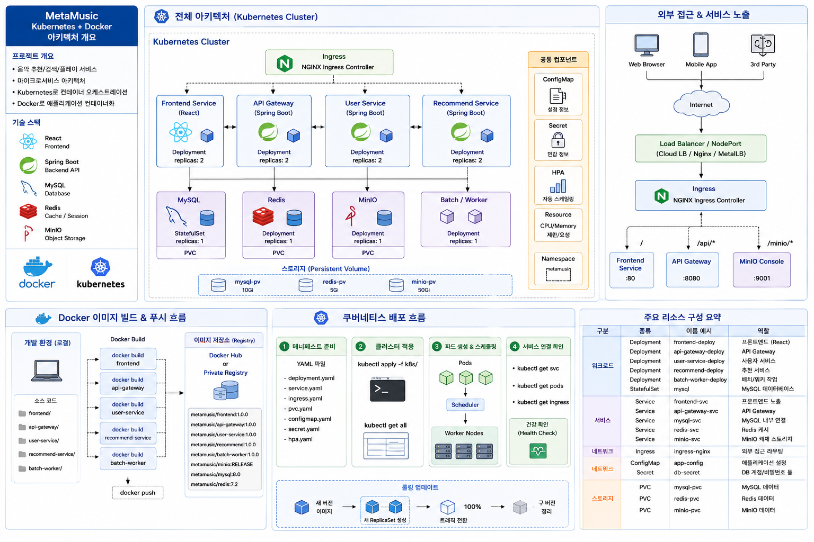
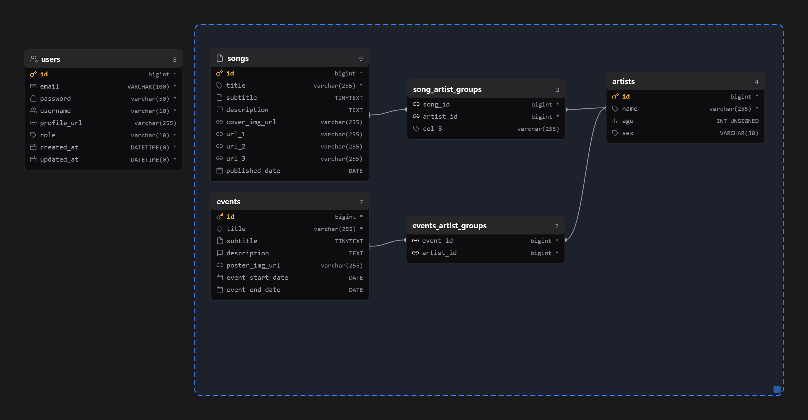

# 쿠버네티스 활용 분산 서버 배포 및 관리




### 목표
Docker Desktop 내장 쿠버네티스에 (1) 단순 웹 서버(nginx), (2) 상태를 가진 분산 시스템(HDFS NameNode/DataNode), (3) 직접 만든 Spring Boot 애플리케이션을 순서대로 올려보며, Deployment·StatefulSet·Service·Probe·RollingUpdate가 각각 어떤 문제를 해결하는 장치인지 파악한다.

### 환경 / 설정

| 항목 | 값 |
|---|---|
| 플랫폼 | Docker Desktop 내장 Kubernetes (context `docker-desktop`) |
| 매니페스트 | `k8s/nginx/nginx.json`, `k8s/hadoop/hadoop-namenode.json`, `k8s/hadoop/hadoop-datanode.json`, `MetaMusic/deploy/k8s/app-deploy.yml` |
| 이미지 | `nginx:latest` · `bde2020/hadoop-{namenode,datanode}:2.0.0-hadoop3.2.1-java8` · `yejun614/meta-music:0.0.1`(직접 빌드) |
| 애플리케이션 이미지 | `deploy/docker/Dockerfile` — `bootJar` 산출물을 Zulu JDK 21 headless 위에 COPY, 단일 스테이지 |

---

## 학습 / 실행 과정

```
[1단계] nginx  — Deployment(replicas 1) + Service(LoadBalancer 30000→80)
   → "파드를 띄우고 외부로 노출한다"의 최소 형태 확인

[2단계] HDFS   — NameNode: headless Service + StatefulSet(replicas 1)
                 DataNode:  StatefulSet(replicas 2), env로 NameNode 주소 주입
   → 상태를 가진 분산 시스템에서 Deployment가 아니라 StatefulSet이 필요한 이유 확인

[3단계] MetaMusic — ./gradlew bootJar → docker build → docker push
                 → Deployment(replicas 3, RollingUpdate) + Probe + Service(LoadBalancer 8800→8080)
   → 무중단 배포를 성립시키는 조건(Probe + graceful shutdown)까지 함께 설정
```

### 1단계 — nginx (Deployment + Service)

| 리소스 | 설정 |
|---|---|
| Deployment | `replicas: 1`, `selector.matchLabels.app=nginx`, 컨테이너 포트 80 |
| Service | `type: LoadBalancer`, `port: 30000` → `targetPort: 80` |

- `kind: List`로 Deployment와 Service를 한 파일에 묶었다 (YAML의 `---` 문서 구분과 같은 역할).
- Service가 파드를 찾는 유일한 수단은 **라벨 셀렉터**다. Deployment의 `template.metadata.labels`와 Service의 `selector`가 문자열 단위로 일치해야 하며, 이름이 아니라 라벨로 연결된다.

### 2단계 — HDFS (StatefulSet + headless Service)

| 리소스 | 설정 |
|---|---|
| `hdfs-namenode` Service | **`clusterIP: None`(headless)**, 포트 rpc 9000 · webui 9870 |
| `hdfs-namenode` StatefulSet | `serviceName: hdfs-namenode`, `replicas: 1`, env `CLUSTER_NAME=k8s-hadoop-cluster` |
| `hdfs-datanode` StatefulSet | `serviceName: hdfs-datanode`, `replicas: 2`, env `SERVICE_PRECONDITION=hdfs-namenode:9000`, `CORE_CONF_fs_defaultFS=hdfs://hdfs-namenode:9000` |

- DataNode는 NameNode의 **IP를 모른 채** `hdfs://hdfs-namenode:9000`이라는 DNS 이름만으로 접속한다. 클러스터 내부 DNS가 Service 이름을 해석해주므로, 파드가 재생성되어 IP가 바뀌어도 설정을 고칠 필요가 없다.
- `SERVICE_PRECONDITION`은 bde2020 이미지가 제공하는 기동 대기 장치로, NameNode가 뜨기 전에 DataNode가 먼저 올라와 실패하는 순서 문제를 흡수한다.
- 앞선 Docker 실습에서는 단일 컨테이너 pseudo-distributed로 NameNode·DataNode를 한 JVM 그룹에 몰아넣었지만, 여기서는 **파드 단위로 역할이 분리**된다. DataNode만 `replicas`를 늘려 수평 확장할 수 있다는 것이 핵심 차이다.

### 3단계 — MetaMusic (무중단 배포 설정)

| 설정 | 값 | 목적 |
|---|---|---|
| `replicas` | 3 | 파드 1개가 죽어도 서비스 유지 |
| `strategy.rollingUpdate` | `maxSurge: 1`, `maxUnavailable: 0` | 새 파드가 Ready가 된 뒤에만 기존 파드를 종료 |
| `resources.requests` | cpu 250m / mem 512Mi | 스케줄러가 노드를 고르는 기준 |
| `resources.limits` | cpu 500m / mem 1Gi | 런타임 상한 (초과 시 throttle / OOMKill) |
| `readinessProbe` | `/api/actuator/health/readiness` (20s 후 5s 간격) | 트래픽을 받을 준비가 됐는지 |
| `livenessProbe` | `/api/actuator/health/liveness` (30s 후 10s 간격) | 살아있는지 (실패 시 재시작) |
| Service | `LoadBalancer`, 8800 → 8080 | 외부 노출 |

애플리케이션 쪽에서 짝을 맞춘 설정 (`application.yaml`):

```yaml
server:
  shutdown: graceful              # SIGTERM 시 처리 중 요청을 마치고 종료
spring:
  lifecycle:
    timeout-per-shutdown-phase: 20s
management:
  endpoints:
    web:
      base-path: /api/actuator    # probe URL의 접두사
      exposure:
        include: health           # health만 노출
  endpoint:
    health:
      show-details: never         # 외부에 내부 정보 노출 금지
      probes:
        enabled: true             # /health/readiness, /health/liveness 활성화
```

`SecurityConfig`에도 `/api/actuator/**`를 `permitAll`로 열어야 한다 — probe 요청에는 JWT가 없으므로, 인증을 걸면 401이 되어 파드가 영원히 Ready에 도달하지 못한다.

---

## 결과

| 항목 | 상태 | 비고 |
|---|---|---|
| nginx 매니페스트 | 작성 완료 | Deployment + LoadBalancer Service |
| HDFS 매니페스트 | 작성 완료 | NameNode headless Service + StatefulSet, DataNode StatefulSet ×2 |
| MetaMusic 이미지 빌드 | **완료** | `yejun614/meta-music:0.0.1`, 약 728MB (`docker images` 확인) |
| MetaMusic 매니페스트 | 작성 완료 | replicas 3 + RollingUpdate + Probe + LoadBalancer |
| 클러스터 적용 | **미완** | 현재 컨텍스트(`docker-desktop`) 전체 네임스페이스에 `meta-music`·`hdfs-*`·`nginx-*` 리소스 없음 |

### 관찰한 것 / 인사이트

- **Deployment vs StatefulSet은 "파드가 서로 구별되어야 하는가"로 갈린다.** nginx 파드는 3개가 완전히 동등해서 어느 것이 죽어도 무관하지만, HDFS DataNode는 각자 다른 블록을 보관하므로 이름·순서·스토리지가 고정되어야 한다. StatefulSet은 `<name>-0`, `<name>-1` 같은 안정적 이름과 순차 기동을 보장한다.
- **headless Service(`clusterIP: None`)는 로드밸런싱을 포기하는 대신 파드 개별 주소를 얻는 장치다.** 일반 Service는 가상 IP 하나로 트래픽을 분산하지만, StatefulSet에서는 "0번 파드에 직접" 접근해야 하는 경우가 있어 DNS가 파드 IP를 그대로 반환해야 한다.
- **`maxUnavailable: 0`만으로는 무중단이 되지 않는다.** 이 설정은 "새 파드가 Ready가 될 때까지 기존 파드를 죽이지 않는다"는 뜻이므로, Ready 판정 기준인 `readinessProbe`가 없으면 컨테이너가 뜬 직후(스프링 컨텍스트 초기화 전)를 Ready로 오판한다. 반대쪽에서는 `graceful shutdown`이 없으면 종료되는 파드가 처리 중이던 요청을 끊는다. **RollingUpdate · readinessProbe · graceful shutdown은 세 개가 한 세트**여야 의미가 있다.
- **`requests`와 `limits`는 역할이 다르다.** `requests`는 스케줄링 시 노드 선택 기준(예약), `limits`는 실행 중 상한. requests만 있으면 노드가 과할당되고, limits만 있으면 스케줄러가 자원을 과소평가한다.
- **애플리케이션 설정과 매니페스트는 서로를 전제한다.** probe 경로(`/api/actuator/health/readiness`)는 매니페스트에 하드코딩되지만 실제로 그 URL을 만들어내는 것은 `management.endpoints.web.base-path` + `health.probes.enabled`이고, 그 URL이 열려 있게 하는 것은 Spring Security 설정이다. 세 곳 중 하나만 틀려도 파드가 Ready에 도달하지 못한다.

> **배운 것** — 쿠버네티스 매니페스트는 "무엇을 몇 개 띄울지"를 적는 파일이 아니라 **"어떤 상태를 정상으로 볼 것인지"를 선언하는 파일**이다. replicas·probe·resources·strategy는 모두 컨트롤러가 "지금 상태가 목표와 다르다"고 판단하는 기준이며, 그 판단 기준을 애플리케이션이 실제로 충족시켜주지 않으면(probe 엔드포인트, graceful shutdown) 선언만 있고 동작은 없다.

---

## 매니페스트 검토에서 발견한 문제

작성한 매니페스트를 다시 읽으며 확인한 결함. 아직 클러스터에 적용하지 않았으므로 대부분 "적용 시 드러날 문제"다.
애플리케이션 쪽 상태는 [SpringSecurity · JPA · Flyway (MetaMusic)](SpringSecurity_JPA_Flyway.md) 노트와 이어진다.

| # | 문제 | 원인 | 조치 |
|---|---|---|---|
| ① | DataNode 파드의 안정적 DNS 이름이 생성되지 않음 | `hdfs-datanode` StatefulSet이 `serviceName: hdfs-datanode`를 지정했으나, 같은 이름의 headless Service가 정의되어 있지 않음 (NameNode 쪽만 정의됨) | DataNode용 headless Service 추가 필요 — 미조치 |
| ② | 파드 재시작 시 HDFS 데이터 유실 | 두 StatefulSet 모두 `volumeClaimTemplates`가 없어 데이터가 컨테이너 레이어에 저장됨. StatefulSet을 쓰는 가장 큰 이유(파드별 영속 볼륨)를 못 살린 상태 | PVC 템플릿 추가 필요 — 미조치 |
| ③ | replicas 3인데 파드마다 DB가 다름 | MetaMusic이 현재 H2 인메모리로 동작 — 파드 3개가 각각 독립된 빈 DB를 가짐. 어느 파드로 라우팅되느냐에 따라 결과가 달라짐 | 외부 MySQL로 전환하고 접속 정보를 Secret/ConfigMap으로 주입 — 미조치 |
| ④ | JWT 시크릿 기본값이 이미지에 포함됨 | `application.yaml`에 `${MMUSIC_JWT_SECRET:<기본값>}` 형태로 실제 키가 하드코딩되어 있어, 환경변수를 주지 않으면 그 값으로 서명됨 | k8s Secret으로 주입하고 기본값 제거 — 미조치 |
| ⑤ | Hadoop 버전 조합 불일치 | bde2020 이미지는 Hadoop 3.2.1 + Java 8. 앞선 Docker 실습에서 3.3.6 + Java 21로 올려둔 환경과 다름 | 실습 목적상 유지, 혼동만 인지 |

> **배운 것** — StatefulSet에서 `serviceName`은 "이 이름의 headless Service가 존재한다"는 **전제**이지 Service를 만들어주는 선언이 아니다. 마찬가지로 `volumeClaimTemplates` 없는 StatefulSet은 이름만 안정적이고 데이터는 휘발되므로, Deployment를 쓰는 것과 실질적 차이가 거의 없다. 리소스 종류를 고르는 것과 그 리소스의 이점을 실제로 얻는 것은 별개다.

---

## 명령어 정리 *(옵션)*

```bash
# 이미지 빌드 및 푸시
./gradlew bootJar
docker build -t yejun614/meta-music:0.0.1 -f deploy/docker/Dockerfile .
docker push yejun614/meta-music:0.0.1

# 적용 / 확인
kubectl apply -f deploy/k8s/app-deploy.yml
kubectl apply -f k8s/nginx/nginx.json
kubectl apply -f k8s/hadoop/hadoop-namenode.json -f k8s/hadoop/hadoop-datanode.json

kubectl get deploy,sts,svc,pods
kubectl rollout status deployment/meta-music-deployment   # 롤링 진행 상황
kubectl describe pod <pod>                                 # probe 실패 원인 확인
kubectl logs -f <pod>
```
